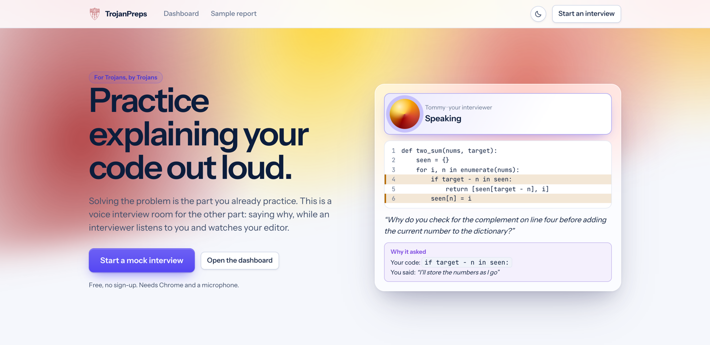
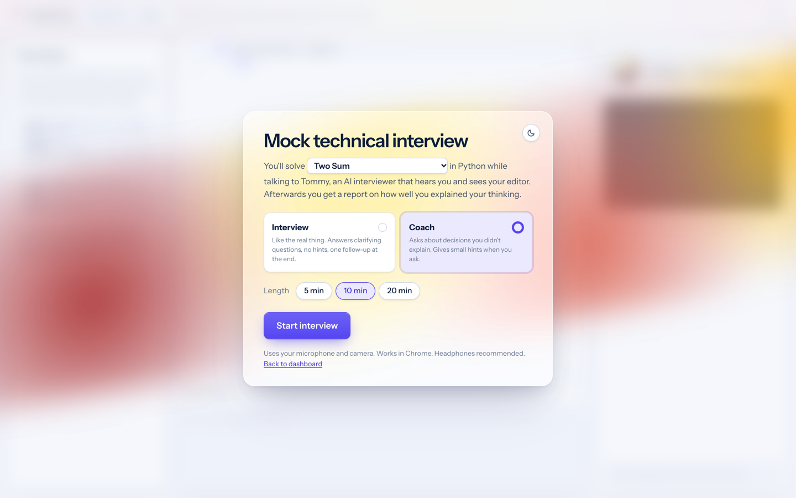
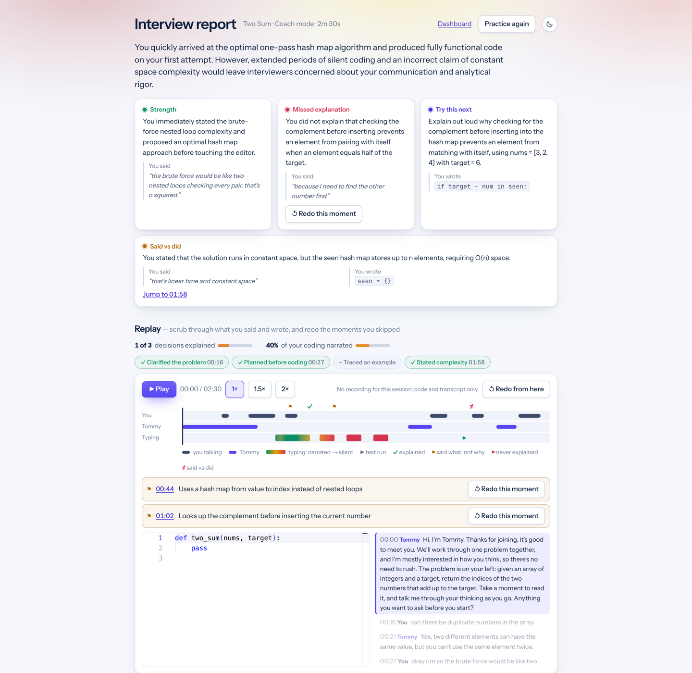
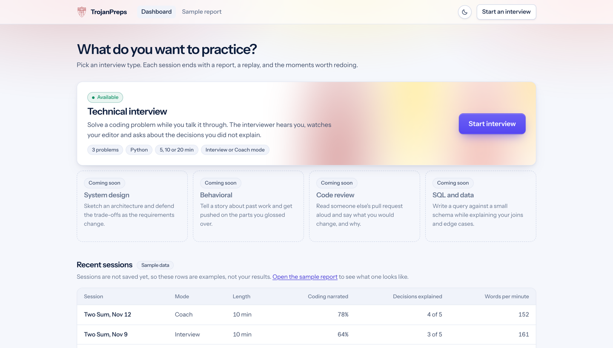

<p align="center">
  
</p>

<h1 align="center">TrojanPreps</h1>

<p align="center">
  <b>Practice explaining your code out loud.</b><br />
  A voice mock interview where the AI interviewer hears you <i>and</i> watches your editor.<br />
  Built at the AI@USC hackathon. For Trojans, by Trojans.
</p>

<p align="center">
  <a href="https://trojanpreps.vercel.app"><b>Try it live</b></a> ·
  <a href="https://trojanpreps.vercel.app/interview?demo">See a sample report</a>
</p>



## Why

LeetCode trains you to solve the problem. Real interviews also grade whether you can **explain** it, out loud, while you code. That part is hard to practise alone.

TrojanPreps is an interview room for it. You talk through a coding problem with **Tommy**, an AI interviewer who:

- **Hears you and sees your code.** Follow-up questions are grounded in both: the line you just typed and what you said (or didn't say) about it.
- **Knows when to stay quiet.** Thinking aloud and pauses don't get interrupted; it waits for you to hand over the floor.
- **Writes a report that quotes you.** Your own words and code are shown back, including moments where what you said contradicts what you wrote.
- **Lets you redo the weak moments.** Jump back to a decision you never explained, answer again, and get re-graded.

## How it works

**1. Pick a problem and a mode.** Three Python problems (Two Sum, Valid Parentheses, Best Time to Buy and Sell Stock). *Interview* mode behaves like the real thing; *Coach* mode probes unexplained decisions and gives small hints when asked.



**2. Talk and code.** Speak naturally while you write Python in the editor. Tests run in the browser. Tommy answers clarifying questions, asks about decisions you skipped over, and keeps an eye on the clock.

**3. Get your report.** Strengths, missed explanations and what to try next, each backed by a quote or a line of code. A timeline replay shows when you talked, when Tommy talked, and how much of your coding was narrated. Every flagged moment has a **Redo** button.



The report also scores clarity, edge cases, complexity and correctness, and measures delivery: speaking pace, filler words, the share of coding you narrated and your longest silent stretch.

**4. Track what to practise.** The dashboard is the starting point. Technical interviews work today; system design, behavioral, code review and SQL are planned.



## Stack

| | |
|---|---|
| App | Next.js (App Router, TypeScript), React, plain CSS |
| Editor and code runner | Monaco; Pyodide runs Python in the browser |
| Speech to text | Deepgram Flux streaming with end-of-turn detection; Chrome's built-in recognizer as a fallback |
| Interviewer and report | Any OpenAI-compatible LLM (currently Gemini) via the `openai` SDK |
| Voice | ElevenLabs, falling back to Chrome's built-in voice |
| Hosting | Vercel |

API keys stay on the server: the browser talks to `app/api/*`, which calls the LLM and TTS providers and mints short-lived Deepgram tokens. The server is stateless; the browser holds the session.

## Run it locally

```bash
cp .env.example .env.local   # add your LLM, Deepgram and ElevenLabs keys
npm install
npm run dev                  # http://localhost:3000, in Chrome
```

Only the LLM key is strictly required. Without a Deepgram key the app uses Chrome's speech recognition, and with `TTS_PROVIDER=browser` it uses Chrome's built-in voice. Every variable is described in [`.env.example`](.env.example) and [ARCHITECTURE.md](ARCHITECTURE.md#running-it).

Use Chrome with a microphone; headphones are recommended so Tommy doesn't hear its own voice.

## Limitations

This is a hackathon MVP: Chrome only, Python only, three problems, and sessions are not saved (the dashboard history is sample data). See [OPEN_ISSUES.md](OPEN_ISSUES.md) for test status and the full list.

## Docs

- [ARCHITECTURE.md](ARCHITECTURE.md): how a session flows, the interviewer's rules, the report, the file map and the demo script
- [OPEN_ISSUES.md](OPEN_ISSUES.md): test status, known limitations and ideas for later
- [AGENTS.md](AGENTS.md): working rules for contributors and coding agents
